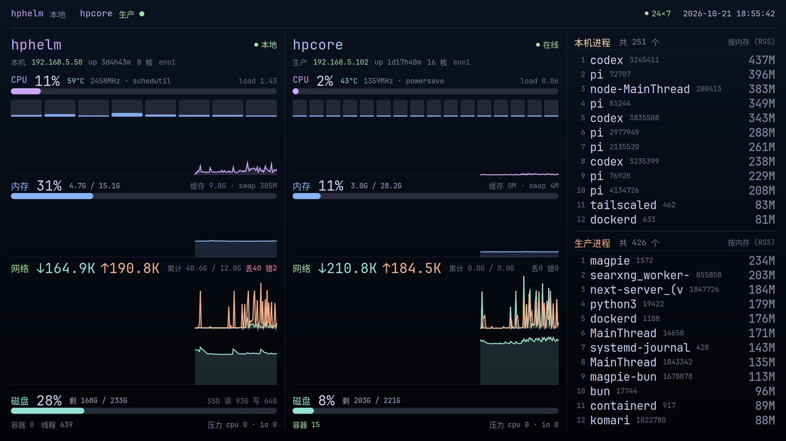
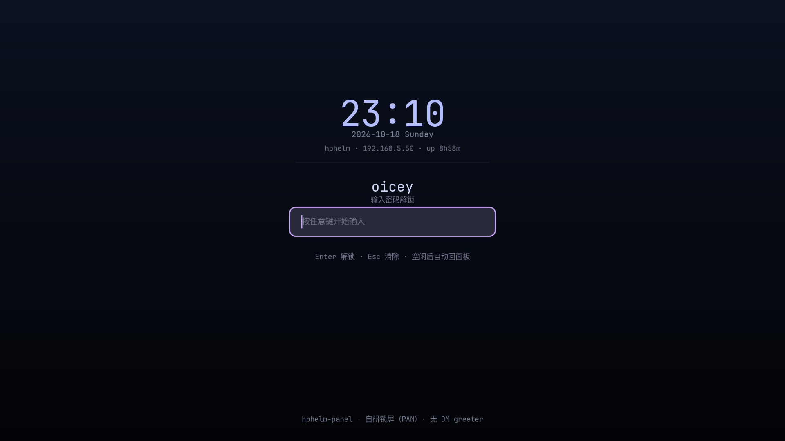

# hphelm-panel

> **English TL;DR** — A hand-drawn (no GUI toolkit) X11 **ops dashboard + lock screen** for exactly
> one machine in my home fleet (`hphelm`): ~2.3k lines of C over cairo + pango, **~1% of one core**,
> ~5 MiB private memory, 2 threads, zero GUI toolkit dependencies. The dashboard shows **two hosts
> side by side** (this workstation + one production server pulled over a single long-lived ssh pipe,
> nothing installed on the remote side). Idle → resource panel; any input → login page; PAM auth →
> desktop; idle again → panel.
> ⚠️ **This is not a drop-in product.** It is *my* answer for *my* machine, wired into our fleet's
> desktop stack and operational rules. Read [「这不是给谁用的」](#这不是给谁用的我为什么这么写)
> before copying anything.



*（真实截图，非渲染图。上面是空闲时的资源面板，下面是同一套自绘风格的登录页。）*



---

## 它做什么

把 `hphelm`（我机队里那台常驻工位的机器）的显示屏当成 **运维看板 + 锁屏**：不操作时显示资源面板，
动一下键鼠进登录页，认证通过回到桌面，再次空闲又回面板 —— **像屏保一样循环**。
登录界面**不用 lightdm 的 greeter**，由本项目自己画、自己认证（setuid 助手 + PAM）。

```
DESKTOP ──idle≥panel_idle──▶ PANEL ──input(≥input_grace)──▶ LOGIN
   ▲                                                          │
   └──────────────────── 认证成功（PAM）──────────────────────┤
LOGIN ──idle≥login_back──▶ PANEL（密码框留空、清错误）
PANEL ──idle≥sleep_off──▶ DPMS 关屏；任意输入唤醒
       └─ sleep_off ≤ 0 ⇒ **永不关屏**（默认，2026-10-19 起）
```

面板是**三列**：`本机 │ 生产服务器 │ 进程榜`（用户口径：「进程排行榜只占一列」「一块屏幕上同时显示
本机跟生产服务器」）。

- **两个主机列完全对称**（同一个 `draw_host()` 画两遍），**每块只占一行**（标题嵌在数值里）：
  - CPU：使用率 · 温度 · 频率 · governor · load · 每核柱 · 5 分钟曲线
  - 内存：使用率 · 已用/总量 · 可回收缓存 · swap · 5 分钟曲线
  - 网络：↑↓ 速率 · 累计流量 · 丢包/错包 · 双曲线
  - 温度曲线 · 磁盘（使用率 · 剩余/总量 · SSD 累计读写 · 进度条）
  - 脚注：容器数 · 线程数 · **PSI 压力**（cpu / io）
  - 纵向是流式的：四张曲线**均分剩余高度**，不浪费版面
- **进程榜一列**：上段本机 12 条、下段生产 12 条（按 RSS 降序，每 3 秒刷新）
- **生产服务器**：ssh 长连接 + 远端 `perl` 探针，**不在被监控机装任何东西**（见下）

### 生产服务器监控（`--remote`）

```
hphelm-panel ──fork/exec──▶ ssh -T hpcore 'perl -'  ──▶ 被监控机的 perl（脚本从 stdin 喂进去）
     ▲                          stdin = tools/probe-remote.pl（本地文件，不落盘到对方）
     └──── 非阻塞读 stdout ───── 1 Hz 的 S/C/P/E 行
```

| 设计点 | 为什么 |
| --- | --- |
| **一条长连接，不是每秒 ssh** | 每次建连 ~100ms + 一次完整握手，还会让远端 sshd 每秒 fork 一个进程 |
| **远端只读 `/proc`、`/sys`** | 不装包、不落文件、不起服务、不开端口 —— 那台是生产机，原则是「必须干净」 |
| **fd 直接进主循环的 `poll`** | 不引入第三个线程，不打断 1 Hz 采样节奏 |
| **只在面板可见时跑** | 桌面态/登录页把子进程停掉（没人看的时候不该有流量），但**保留已采到的数据** |
| **半帧不提交** | `S`/`C`/`P` 写进暂存，收到 `E` 才整体提交 ⇒ 视图读不到「CPU 是新的、进程榜是空的」 |
| **退避重连** | 2→4→8→16→30 秒封顶；断线时列标题旁显示「离线 Ns」，主循环照常跑 |

实测成本：远端 `perl` **~0.3% of one core**，本机 `ssh` 进程 <0.1%。
配置写在 `/etc/hphelm-panel.conf`（`remote=hpcore`），优先级 `--remote` > `$HPHELM_REMOTE` > 该文件。
**没配就没有右列**（面板会写「未配置」，不拿本机数据冒充）。

## 为什么是「自己画」——这是实测选出来的，不是偏好

同一台机、真桌面、同一份 1 Hz 工作量：

| 路线 | 实现 | PSS | CPU | 线程 |
| --- | --- | --- | --- | --- |
| **本项目** | **X11 + cairo + pango（C，无工具包）** | **7.4 MiB**（最小程序） | 0.08% | **2** |
| 轻量包 | FLTK | 8.4 MiB | 0.08% | 2 |
| 现成 | conky | 13.4 MiB | 1.33% | 6 |
| 工具包 | GTK3 + C | 17.6 MiB | 0.08% | 5 |
| 工具包 | Qt6 Widgets | 27.4 MiB | 0.42% | 3 |
| 工具包 | GTK3 + Python | 37.1 MiB | 0.08% | 5 |
| 工具包 | **GTK4 + C** | **119.3 MiB** | 0.50% | **22** |

**结论**：内存的大头是**工具包**，不是语言（C 14.1 MiB vs Rust 14.5 MiB，只差 0.4 MiB）。
所以这个项目用 C + cairo + pango，**坚决不引工具包**。

自绘不吃文字质量的亏：cairo + pango 就是 GTK 底下那同一套（cairo/pango/fontconfig/harfbuzz）。
实测只给一个「只有拉丁字形」的字体族（DejaVu Sans）画「中文测试 汉字」，再换 Noto CJK 重画，
**只差 112 像素（0.001%）** ⇒ 字体回退生效，中文与 Nerd Font 图标正常。
另外自绘能精确 `cairo_scale(1.48)` 对上本机 141.8 DPI（GTK 在 X11 只支持整数倍缩放）。

**本程序实测（真机）**：`PSS 24.8 MiB`（其中 **Pss_Anon / Private 仅 5.4 MiB**，其余是与
X/picom/pango 共享的库页）· 2 线程。
CPU 在加第二台主机后从 **0.60% → 约 1.0%（只本机）/ 约 1.4%（含生产服务器）of one core**
（一帧绘制 5~10ms、1 Hz 重绘；实测瓶颈是 pango 整形次数与整屏渐变填充，两者本轮都已优化：
右对齐复用同一次排版、背景渐变只渲染一次再 `XCopyArea` 复制）。
⚠️ 早期文档里的 0.60% 是在「只有一台主机、进程榜 40 条」的版式下量的，与现在不可直接比较。

## 这不是给谁用的（我为什么这么写）

**这个仓库是我方案的展示，不是通用面板框架。** 它每一行都长在下面这些前提上，换台机器基本都得改：

| 前提 | 具体是什么 | 换环境要改什么 |
| --- | --- | --- |
| **屏幕** | 1920×1080 / 141.8 DPI ⇒ `SCALE=1.48`，版式常量按 **1297×729 逻辑像素**调的 | 改 `--scale` 或 `src/theme.h` 的 `L_*` 常量；换分辨率要重新调版式 |
| **桌面栈** | lightdm(autologin) + bspwm + polybar + picom；面板是 `override-redirect` 全屏覆盖层 | 没有 autologin 的机器上「回桌面」这一步不成立；堆叠/抬窗逻辑要重验 |
| **认证** | 需要**专用 PAM 服务** `/etc/pam.d/hphelm-auth`（只留 `pam_unix`）；setuid 助手装到 `/usr/local/libexec/` | ⛔ **绝不要复用 `login` 栈**（带 `pam_faillock` ⇒ 会把 autologin 一起锁死，我们实测踩过）；换发行版要自己写这份 PAM 配置 |
| **会话入口** | `/usr/local/bin/hphelm-session` 里起面板 + 守护循环 + 日志轮转 | 得自己接进你的 DM/会话 |
| **运维红线** | 「永不向 lightdm 发锁请求」「守护循环只把运行 <5 秒当失败」「回滚先停 VT 守卫」 | 这三条是我们机队用**血的教训**换来的（见 `docs/pitfalls.md`），直接抄代码但不知道这三条会踩同一个坑 |
| **字体** | JetBrainsMono Nerd Font（图标 + 中文回退靠 fontconfig） | 换字体要重验宽度，版式是拿它量的 |
| **数据源** | Linux `/proc`、`/sys`：`k10temp` 温度、`nvme*` 统计、zram swap、`/sys/class/net/<iface>` | 温度与磁盘的设备路径是**本机硬件**；非 Linux 不成立 |
| **机队口径** | 顶栏那个 `24×7` 标记、tailscale 状态、进程榜按 RSS……都是**我们机队**的看板语义 | 这些不是通用概念，别当成「面板标配」 |

一句话：**「自绘、无工具包、低占用」这套方法可以拿走；「这份代码」拿走要付适配成本。**

## 构建与部署

```sh
make                 # 需要 pkg-config: x11 x11-xcb xscrnsaver cairo cairo-xlib pangocairo
sudo make install    # → /usr/local/bin/hphelm-panel
                     # → /usr/local/libexec/hphelm-auth（4755 root:root，setuid）
```

⚠️ **构建必须在目标机 `hphelm` 上做**（需要 X 开发头文件；无头机器上 `make` 会失败）。
**2026-10-19 起源码目录与部署目录是同一个**：`/data/dev/hphelm-panel`，所以现在没有 rsync ——
`tools/deploy.sh` 就在本机构建、安装、重启、跑判据。

部署到 `hphelm` 的完整流程（含红线守卫、三层回滚、六件绝不能做的事）见 **[`docs/deploy.md`](docs/deploy.md)**；
一条命令的版本是 `tools/deploy.sh`（`--check` 只读）。

常用参数：

```sh
hphelm-panel --panel-idle 180     # 桌面空闲多久进面板（秒）
hphelm-panel --login-back 120     # 登录页空闲多久回面板（秒）
hphelm-panel --input-grace 1.2    # 进面板后多久才接受唤醒（防误触）
hphelm-panel --sleep-off 0       # 面板空闲多久关屏（DPMS）；**0 或负数 = 永不关屏（默认）**
hphelm-panel --scale 1.48         # 缩放（物理/逻辑像素比）
hphelm-panel --remote hpcore      # 生产服务器（ssh 目标）；空 = 只显示本机
hphelm-panel --lock /tmp/x.lock   # 单实例锁路径（默认 /tmp/hphelm-panel.lock）
hphelm-panel --state panel|login  # 强制初始状态（验证界面用）
hphelm-panel --dump               # 只打采集层数据后退出（不需要 X）
HPHELM_PANEL_DEBUG=1 …            # 主循环仪表：it/s · poll 结果 · 事件类型 · 各阶段耗时
```

## 文档地图

| 你想干什么 | 先读 |
| --- | --- |
| **接手维护这个项目**（AI/人都一样） | **[`AGENTS.md`](AGENTS.md)** ← 工作流、红线、验收判据、不要做什么 |
| 看逐轮交接与当前待办 | [`HANDOFF.md`](HANDOFF.md) |
| 改 UI / 版式 / 配色 | [`docs/design.md`](docs/design.md)（设计系统 + 版式常量 + 曲线规范） |
| 搞清状态机 / 双缓冲 / 认证模型 / 数据采集 | [`docs/architecture.md`](docs/architecture.md) |
| **看不到图时怎么验 UI**（本项目最关键的方法论） | [`docs/verify.md`](docs/verify.md) |
| 部署 / 重启 / 回滚 | [`docs/deploy.md`](docs/deploy.md) |
| 已踩过的坑（14 条，每条带判据） | [`docs/pitfalls.md`](docs/pitfalls.md) |

## 目录结构

```
src/theme.h         配色（Catppuccin Mocha）+ 版式常量（逻辑像素）
src/metrics.[ch]    本机数据采集：只读 /proc、/sys，不 fork 子进程
src/remote.[ch]     生产服务器采集：ssh 长连接 + 非阻塞行解析 + 退避重连
src/view.[ch]       绘制基元：文字/背景渐变/细线/进度条/每核柱/sparkline/量程量化
src/view_panel.c    面板版面（无卡片、三列：本机 │ 生产 │ 进程榜）
src/view_login.c    登录页版面（无卡片、居中）
src/auth.[ch]       与 setuid 助手通信（密码只走 stdin）
src/hphelm-auth.c   唯一的特权代码：setuid root，调 PAM 验一次密码
src/panel.c         X11 窗口、事件、状态机、主循环、双缓冲
tools/              渲染验证（render-ascii/render-region/measure）、帧差分探针、部署脚本、
                    probe-remote.pl（喂给被监控机的只读探针）
docs/               架构 / 设计 / 验证 / 坑 / 部署
```

## 状态与边界

- **活跃**：这是 `hphelm` 上正在跑的方案（看板 + 锁屏都是它）。
- **不做**：不做成通用面板、不做配置系统、不做主题系统、不引 GUI 工具包、不追跨平台。
  想「通用化」的改动一律先问「这是不是把我这台机的假设包装成了产品」。
- **没有 license 文件** = 保留所有权利（和我其它仓库一致）。要拿去用请先读上面那张适配表，
  或者直接把它当成「一个具体方案长什么样」的参考。

## 相关

- 机队视角的运维记录（部署位置、VT 守卫、红线）：`kb` 仓库的 `runbooks/hphelm.md`
  「运维面板（hphelm-panel）」节（kb 主副本在 `hphelm:/data/kb`）。**那是机队事实的权威来源**，
  本项目文档负责代码与设计。
- 项目记忆库：`.ai/`（`engram dump` 出 ≤1.5 KB 会话指纹；`engram doctor` 查漂移）。

## 真实可移植的做法

想把「自绘、无工具包、低占用」用到自己机器上，**照方法走，不要照抄代码**：

1. **先量再选**：在你自己的机器上复现上面那张选型表（同一份 1 Hz 工作量，比 PSS/CPU/线程）。
   结论很可能是「工具包才是大头」——那就自绘。
2. **渲染骨架**：离屏 pixmap + 每帧一次 `XCopyArea`（不要直接画窗口，会闪）；
   GC 记得关 `graphics_exposures`（否则主循环自激空转）。细节见 `docs/architecture.md`。
3. **认证**：写一个「只做一件事」的 setuid 助手（读 stdin 密码 → PAM 验一次 → 打印 OK/FAIL），
   配一个专用 PAM 服务。**绝不复用 `login` 栈**（会连坐 autologin）。
4. **版式**：先定「逻辑像素」坐标系和一组 `L_*` 常量，再画。
5. **验证**：准备三个探针——整屏 ASCII、几何测量（色块游程/墨迹带）、帧差分。看不到图也能改 UI。

⇒ 这份代码的价值在于**它记录了我们踩过的坑与判据**（`docs/pitfalls.md` 14 条）。
